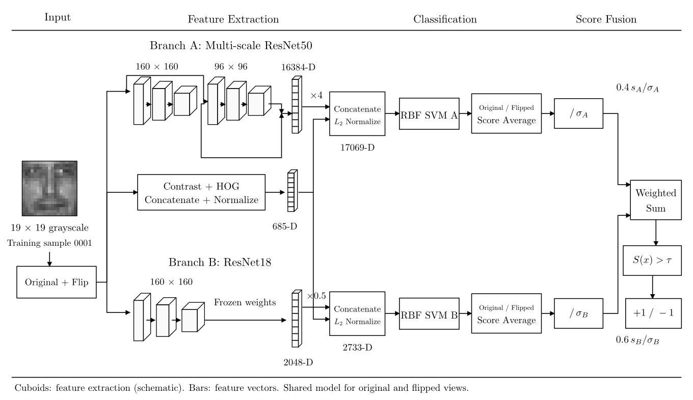
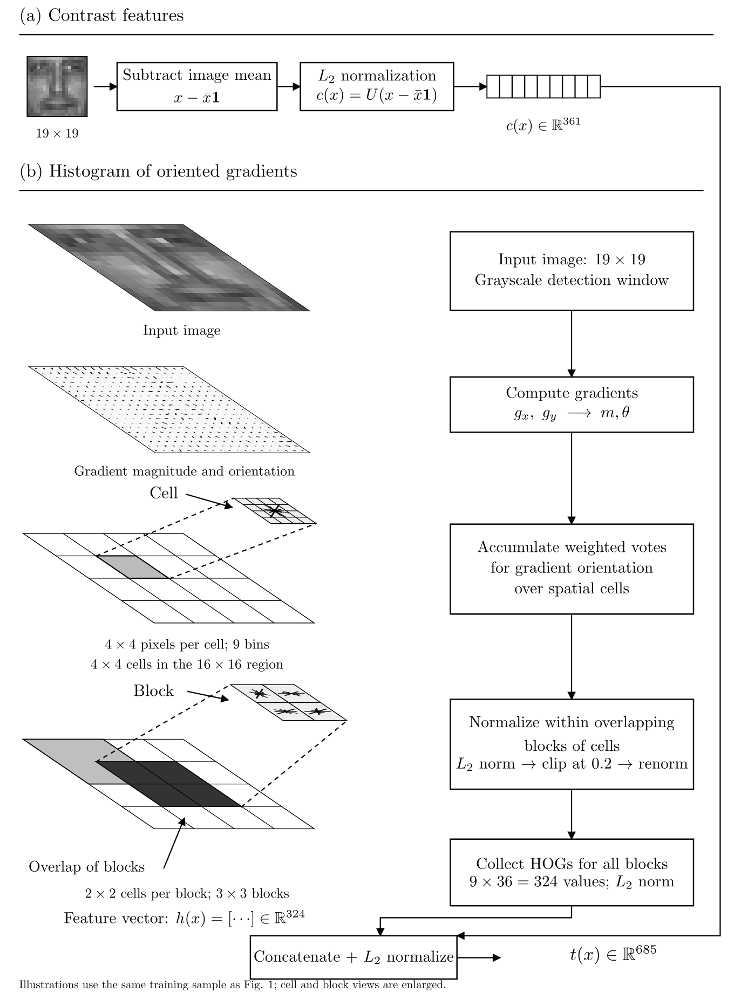
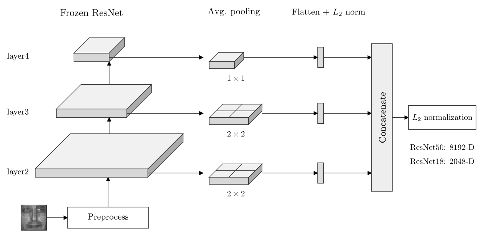
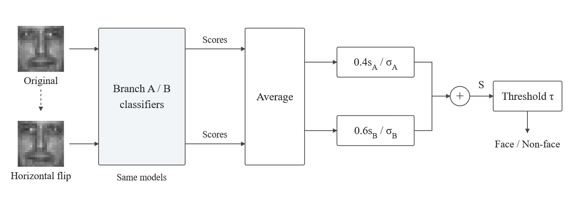
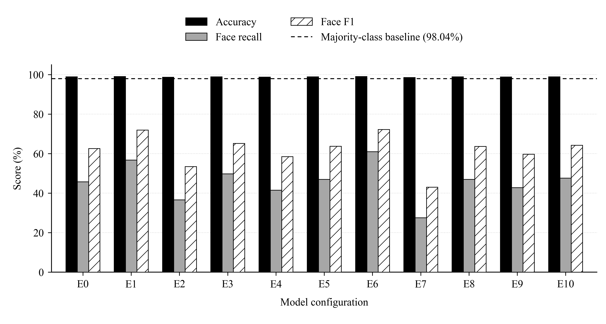
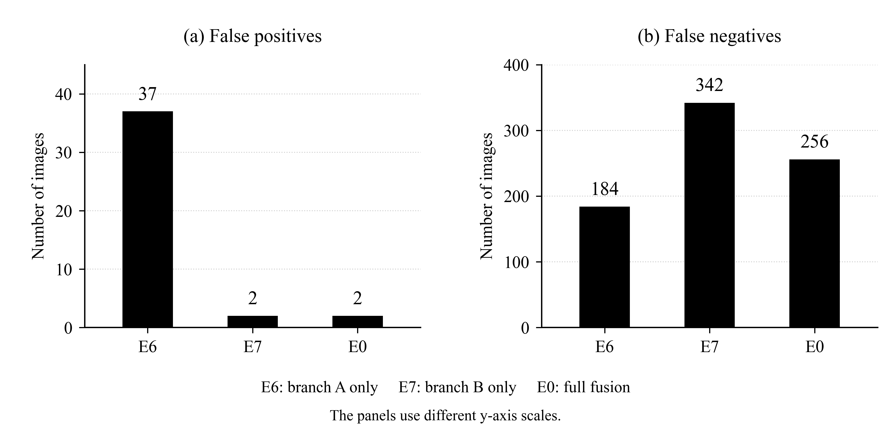
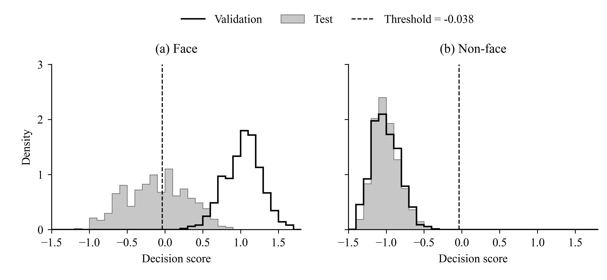

# 人脸分类程序思路与方法及实验结果分析

[下载 Word 报告](docs/人脸分类实验报告.docx) · [代码运行与复现](docs/REPRODUCING.md) · [课程平台ACC](course800/platform_acc.csv) · [完整集结果](full31022/results.csv)

> 课程800/420的ACC由作者确认为平台成绩，未独立核验；完整数据集指标来自随仓库发布的冻结评价结果。

## 人脸分类程序思路与方法

基于传统特征与多尺度 ResNet 特征的双 SVM 融合

## 1 总体设计思路

本程序针对19×19灰度图像的人脸与非人脸二分类任务，采用“特征提取、分支分类、分数融合”的处理框架。输入图像先构造对比度特征和方向梯度直方图特征，再利用冻结的预训练ResNet提取迁移特征，将两类特征组合后交由径向基核支持向量机分类。最终通过两个分类分支的连续决策分数融合，输出+1或−1标签，其中+1表示人脸，−1表示非人脸。

设计上，对比度特征保留灰度空间分布，HOG描述局部边缘与轮廓，ResNet特征提供不同层级的卷积响应。分支A使用ResNet50在160和96两种输入尺度上的组合特征，分支B使用ResNet18在160尺度上的特征。两个分支分别设置特征幅度与核参数，使其形成不同的判别方式，再在输出端融合。上述互补性是方法设计依据，具体效果需由消融实验检验。

## 2 程序处理流程

训练阶段依次完成数据读取与检查、水平镜像扩增、传统特征提取、迁移特征缓存读取、分支特征拼接、核矩阵计算以及两个SVM的拟合。开发阶段计算原图与镜像图的决策分数，确定分数尺度与分类阈值。预测阶段沿用相同特征处理与已固定的融合参数，生成按样本编号排列的分类结果。

图1 双分支人脸分类方法总体框架

图例：x为输入灰度图像，t为共享传统特征，d_A与d_B为两路迁移特征；U表示L2归一化，SVM A与SVM B为独立训练的分类器。

图示说明：输入图像及其水平镜像分别提取共享的对比度与HOG特征，以及两路冻结ResNet迁移特征。ResNet50分支融合160与96两个尺度的表示，ResNet18分支采用160尺度表示；两路迁移特征分别以4和0.5的幅度与传统特征拼接并单位化。各分支经RBF SVM分类后，将原图与镜像的分数平均，除以各自标准差，再按0.4与0.6加权融合，通过阈值输出人脸或非人脸标签。图中长方体为特征提取示意，不代表实际网络层数或张量尺寸。

## 3 数据组织与输入约定

数据由MAT文件读取，每行表示一张图像，每张图像为361维向量。当前实现使用800个原始训练样本，两类各400个；420个带人工参考标签的样本用于开发与阈值选择。训练样本与开发样本分别保存，不将开发样本及其标签加入本次SVM拟合。程序检查矩阵形状、数值有限性和标签集合，避免异常输入进入后续计算。

表1 数据划分与使用方式

| 数据或视图 | 数量及构成 | SVM拟合 | 标度估计 | 阈值选择 |
| --- | --- | --- | --- | --- |
| 原始训练集 | 800张；人脸400张，非人脸400张 | 是；完整模型中各权重0.5 | 否 | 否 |
| 镜像训练视图 | 800个原图＋800个镜像，共1600个视图 | 是；每个视图权重0.5 | 否 | 否 |
| 开发集 | 420张；人脸120张，非人脸300张 | 否 | 是；由分支分数估计σ | 是；使用人工参考标签 |

原始训练集与镜像训练视图描述同一训练数据的两种组织方式，数量不能相加。镜像视图不是新增独立样本；标度估计使用开发分数，不需要标签，阈值选择需要开发标签。

图像向量沿用MATLAB按列展开的存储顺序，提取HOG和CNN特征时通过reshape后转置还原空间方向。水平镜像也按这一约定实现，保证传统特征与迁移特征对应同一图像视图。特征提取脚本直接读取原始矩阵；通用读取函数另支持将0至255输入缩放至0至1，使用新输入时应保持与训练缓存一致的像素尺度。

## 传统特征与迁移特征提取

## 4 对比度特征与HOG特征

设输入向量为x，U(v)=v/max(‖v‖₂,10⁻¹²)表示L2归一化。对比度特征先减去该图像所有像素的平均值，再进行单位化，以减弱整体亮度偏移和整体幅度差异的影响。该特征仍保留各像素相对图像均值的空间分布，维数为361。

c(x) = U(x − mean(x))

HOG先在还原后的19×19图像上计算两个方向的数值梯度，得到梯度幅值和方向。方向映射到[0,π)，划分为9个方向区间，按梯度幅值将每个像素的贡献线性分配给相邻的两个方向区间。实现将索引1至16的内部区域分成4×4个单元，每个单元含4×4个像素；外围像素不直接累加至直方图，但可能参与边界附近梯度的计算。

随后以2×2个单元组成局部块，按一个单元的步长滑动，形成3×3个块。每块包含36维直方图，依次进行L2归一化、0.2上限截断和再次归一化，最后将9个块拼接并整体归一化，得到324维HOG向量。完整传统特征使用对比度与HOG等幅拼接，得到685维表示。

t(x) = U([c(x), h(x)])，dim(t) = 361 + 324 = 685

图2 对比度与HOG特征构造过程

图例：上半图为对比度特征c(x)，下半图为HOG特征h(x)；U为L2归一化，单元为4×4像素，局部块为2×2个单元。

图示说明：上部展示图像减均值和L2归一化得到361维对比度特征；下部左侧用倾斜图像平面、梯度场、单元拉出放大及局部块重叠示意解释HOG，右侧展示对应计算流程。HOG在19×19图像的内部16×16区域累加梯度，形成4×4个单元，每个单元包含4×4像素并生成9方向直方图；以2×2个单元构成局部块，按一个单元步长得到3×3个重叠块。各块依次归一化、0.2截断及再次归一化，拼接并整体归一化得到324维HOG，最终与对比度特征拼接并归一化为685维表示。

## 5 冻结ResNet提取多层级特征

迁移特征使用加载预训练权重的ResNet18和ResNet50。网络设置为eval模式，在torch.inference_mode下前向计算，不对卷积网络进行反向传播或微调。灰度图像先双线性插值到指定尺寸，再复制为3通道，使用均值[0.485,0.456,0.406]和标准差[0.229,0.224,0.225]逐通道标准化。插值只改变网络输入采样尺度，不增加原始19×19图像中已有的信息。

特征不是网络最终分类层的输出，而是layer2、layer3和layer4的响应。对layer2与layer3分别进行2×2自适应平均池化，对layer4进行1×1自适应平均池化，再展平为向量。三个层级的向量各自单位化后拼接，并再次单位化。

dᵣ(x) = U([U(pool₂×₂(L₂)), U(pool₂×₂(L₃)), U(pool₁×₁(L₄))])

ResNet50三个部分分别为2048、4096和2048维，每个尺度合计8192维；ResNet18对应512、1024和512维，合计2048维。提取结果按train、train_mirror、test、test_mirror四个键保存为NPZ缓存，本次消融脚本读取既有缓存，不重复执行CNN前向提取。

图3 冻结ResNet的多层级特征提取

图例：三个倾斜平面表示layer2、layer3和layer4的特征；Avg. pooling表示自适应平均池化，细条表示展平并完成L2归一化后的特征向量；Concatenate表示拼接。网络参数冻结，特征平面大小为示意。

图示说明：输入图像经尺寸缩放、三通道复制和通道标准化后进入冻结的ResNet。从layer2、layer3和layer4分别提取特征，依次采用2×2、2×2和1×1自适应平均池化，再展平、分别进行L2归一化、拼接并整体归一化。ResNet50三个层级分别得到2048、4096和2048维特征，每个尺度拼接为8192维；ResNet18分别得到512、1024和512维特征，拼接为2048维。分支A在160和96两个尺度分别执行该流程，将两个8192维表示拼接并归一化为16384维。尺寸插值不增加原始图像信息。

## 双分支特征构造与支持向量机训练

## 6 多尺度与传统特征融合

分支A将ResNet50在160×160和96×96尺度提取的向量拼接后单位化，得到16384维多尺度迁移表示；分支B采用ResNet18在160×160尺度提取的2048维表示。两个分支各自与相同的685维传统特征组合。

d_A(x) = U([d₅₀,₁₆₀(x), d₅₀,₉₆(x)])，d_B(x) = d₁₈,₁₆₀(x)

f_A(x) = U([t(x), 4d_A(x)])，f_B(x) = U([t(x), 0.5d_B(x)])

系数4和0.5是拼接前的迁移特征幅度，用来调节传统特征块与迁移特征块在最终向量中的相对占比；它们与输出分数的融合权重含义不同。最终特征再次单位化，以便在统一向量范数下计算核距离。

表2 两个分类分支的配置对比

| 配置项 | 分支A | 分支B |
| --- | --- | --- |
| 迁移网络 | ResNet50 | ResNet18 |
| 输入尺度 | 160与96 | 160 |
| 迁移特征维数 | 16384 | 2048 |
| 完整特征维数 | 17069 | 2733 |
| 迁移特征幅度 | 4.0 | 0.5 |
| SVM惩罚参数C | 100 | 1 |
| RBF参数γ | 0.1 | 2.0 |
| 输出融合权重 | 0.4 | 0.6 |

## 7 镜像训练与RBF核分类

训练时，对每个原始样本生成水平镜像，并沿用原类别标签。800个原始样本因此对应1600个训练视图。原图和镜像图的sample_weight均设为0.5，使每个原始样本连同镜像的总权重仍为1；不使用镜像训练的对照则为800个视图，每个权重为1，从而避免仅因视图数翻倍而增大总惩罚权重。

每个分支独立训练RBF核SVM。对于已经单位化的特征，平方欧氏距离可由内积计算；实现将微小负值截为0，减小浮点误差的影响。先生成训练核矩阵，再以kernel="precomputed"传给SVC。

K(u,v) = exp(−γ max(2 − 2uᵀv, 0))

SVC使用tol=10⁻⁴、max_iter=100000和512 MB核缓存，并检查fit_status为0。预测时计算待分类特征与训练特征之间的核矩阵，由decision_function得到连续决策分数。该分数用于后续融合，不是经过概率校准的人脸概率。

## 镜像推理与融合判别方法

## 8 原图与镜像分数平均

推理阶段，原图与水平镜像图分别经过相同的特征提取和同一个分支分类器。对两个连续决策分数取算术平均，再进行分支间融合。镜像推理与镜像训练是两个独立步骤：前者改变单个样本的输出汇总方式，后者改变参与拟合的训练视图。

s_b(x) = [g_b(f_b(x)) + g_b(f_b(flip(x)))] / 2，b∈{A,B}

其中g_b表示第b个SVM的决策函数。先平均连续分数可保留分类器对不同视图的判别强度；本实现不采用两张图预测标签的多数投票。关闭镜像推理时，直接使用原图分数。

## 9 分数标度统一与加权融合

由于两个SVM的C、γ和特征组合不同，其决策分数的变化范围也不同。程序分别计算开发样本分支分数的总体标准差σ，采用ddof=0，并将各分支分数除以相应标准差，再按0.4和0.6加权求和。此处不减去分数均值，因此属于尺度调整，而非完整的z-score标准化。

S(x) = 0.4s_A(x)/σ_A + 0.6s_B(x)/σ_B

当前配置的σ_A约为0.6854236833，σ_B约为0.4791899848。部署到新样本时应直接使用保存的标度常数和融合权重，不能对每一批待预测样本重新估计标准差，否则同一图像的输出可能随批次组成发生变化。

## 10 分类阈值的选择与使用

最终标签由融合分数与阈值τ比较得到。当S(x)>τ时判为人脸，否则判为非人脸。当前保存的完整模型阈值为−1.7275275918；不能将其替换为默认的0而仍视作同一判别规则。

ŷ(x) = +1，若S(x)>τ；否则ŷ(x) = −1

图4 镜像推理与双分支分数融合

图例：Original为原图，Horizontal flip为水平镜像；Branch A / B classifiers为两分支分类器，Average为各分支的原图与镜像分数平均；σ_A、σ_B为保存的分数标准差，τ为分类阈值。

图示说明：原图及其水平镜像使用同一组A、B分支分类器，分别对各分支的两视图连续分数取平均。平均分数除以各自保存的标准差后，以0.4和0.6加权求和；融合分数大于τ时输出人脸，否则输出非人脸。尺度调整只除以标准差，不减均值。

消融脚本按分数升序排列开发样本，枚举相邻不同分数之间的分割点以及两端边界，选择开发集分类正确数最多的位置。并列最优时，取升序扫描遇到的第一个分割点。该规则以run_ablation.py中的threshold函数为准，区别于旧工具函数中按阈值绝对值处理并列情况的实现。

SVM拟合未使用420个开发样本的标签，但阈值选择使用了这些标签，历史配置与融合方案也曾依据它们选择。因此，开发集上的分类指标反映当前数据上的拟合与选择结果，不能解释为独立测试泛化性能。新数据评价时，应先冻结特征流程、分支参数、标度常数、权重和阈值。

## 程序组织与消融实现方法

## 11 模块划分与执行逻辑

数据模块负责读取MAT矩阵、检查尺寸和标签版本。特征模块调用face_model.py中的unit、contrast、hog、features和flip，并加载三组CNN缓存。分类模块由fitbranch统一生成特征、拟合SVM和计算原图及镜像分数。融合模块根据实验配置选择分支和权重，完成分数标度调整、阈值选择及预测输出。

fitbranch以分支、传统特征类型、迁移特征来源和镜像训练开关共同标识训练任务。相同配置在内存中复用；当模型和分数文件均已存在时可恢复读取。E6、E7、E9和E10可以复用完整分支的已算分数，避免为只改变融合或推理方式的对照重复拟合。当前11组消融实际对应12次不同SVM拟合。

## 12 消融变量的控制方式

表3 消融实验设置与控制变量

| 组别 | 相对完整模型的改动 | 镜像训练 | 镜像推理 | 分数标度与阈值 |
| --- | --- | --- | --- | --- |
| E0 | 完整模型 | 开 | 开 | 本组估计与选择；与历史配置核验 |
| E1 | 去掉对比度，保留HOG | 开 | 开 | 本组重新估计σ并选择τ |
| E2 | 去掉HOG，保留对比度 | 开 | 开 | 本组重新估计σ并选择τ |
| E3 | 去掉全部传统特征 | 开 | 开 | 本组重新估计σ并选择τ |
| E4 | 分支A仅160尺度 | 开 | 开 | 本组重新估计σ并选择τ |
| E5 | 分支A仅96尺度 | 开 | 开 | 本组重新估计σ并选择τ |
| E6 | 仅分支A，输出权重1 | 开 | 开 | A路分数估计σ并选择τ |
| E7 | 仅分支B，输出权重1 | 开 | 开 | B路分数估计σ并选择τ |
| E8 | 不使用镜像训练增强 | 关 | 开 | 本组重新估计σ并选择τ |
| E9 | 仅原图推理 | 开 | 关 | 主评价重估σ与τ；另固定完整模型σ与τ |
| E10 | 输出权重改为0.5与0.5 | 开 | 开 | 主评价重估σ与τ；另固定完整模型σ与τ |

表中“开”表示使用相应镜像操作。除表列改动外，保留相同训练与开发数据、特征归一化规则，以及所保留分支的C、γ和迁移幅度。E6和E7的单分支权重为1；E9与E10的固定校准结果为附加评价，与各自主评价同时保存。

各组固定已有C、γ和保留特征的外层幅度，不进行组内超参数搜索。删除一个传统特征块后，将剩余传统块单位化，再与迁移块组合；删除全部传统特征时直接使用迁移表示。各组通常重新估计自己的分数标准差并选择开发阈值。E9和E10另使用完整模型保存的标准差与阈值评价，以观察固定校准条件下推理策略或权重变化的影响。

这一设计用于分析已选配置附近各组成部分的作用，不能代表每一种简化模型经过充分调参后的性能上限。后续较大数据集实验应保留相同变量定义，并明确训练集、开发集与独立测试集的用途。

## 13 保存与核验

公开课程脚本保存模型、原图与镜像分数、融合分数、预测标签及配置记录；每行预测包含从1开始的编号与类别，不计算420张样本的本地测试指标。完整数据集另通过verify_full.py核验指标、预测顺序和冻结阈值。

预计算核SVM的紧凑模型文件不包含完整训练特征。重新对新样本推理时，需保留或重建训练特征，并为新样本提取对应的传统特征和CNN特征。现有predict_multiscale.py依赖既定420个样本的缓存；扩展到任意新图像时，需补充新图像的特征提取入口。

公开实现：common/face_model.py、course800/extract_features.py、course800/run_ablation.py及frozen_calibration.json；完整数据集实现位于full31022目录。公开课程脚本使用历史冻结校准常数生成预测，不读取测试标签，不计算本地测试指标。历史阈值曾借助人工参考标签选择，此开发过程不构成独立测试评价。

实验结果与分析

## 1 模型与评价设置

本节围绕课程实验中平台ACC最高的模型展开分析。该模型将对比度特征、HOG与冻结ResNet迁移特征结合，采用双SVM分数融合：分支A使用ResNet50的160与96双尺度特征，分支B使用ResNet18的160尺度特征；各分支对原图与镜像分数取平均，经标准差缩放后按0.4与0.6加权融合。

实验分为两部分：首先报告800张训练图像与420张课程测试图像设置下的完整模型及E1—E10消融平台ACC，再使用31,022张MIT CBCL图像重新训练和评价相同方案。课程测试集不提供官方标签，只报告作者确认的平台ACC，不报告本地测试召回率、F1或混淆矩阵。完整数据集具有标签，可进一步分析召回率、F1、ROC AUC及误报和漏报。

完整模型使用800张原始训练图像及其镜像拟合分类器，在420张课程测试图像上的历史平台ACC为97.4%，是已有提交记录中的最高值。以下将该方案记为E0，并以其为对照考察各组成部分的作用。这里的“最佳模型”指课程平台提交成绩最佳，不表示其在完整数据集的所有评价指标上也最优。

## 2 课程数据上的完整模型与消融结果

以最终模型为对照，分别去除传统特征、修改ResNet50尺度、取消分支融合，以及调整镜像策略与融合权重。除目标组件外，保留原有主要配置，不对各简化方案重新开展完整参数搜索。

表1 800／420设置下的平台ACC

| 编号 | 实验方案 | 平台ACC | 相对完整模型变化 |
| --- | --- | --- | --- |
| E0 | 完整模型 | 97.38% | — |
| E1 | 去掉对比度特征 | 95.71% | −1.67个百分点 |
| E2 | 去掉HOG特征 | 94.76% | −2.62个百分点 |
| E3 | 去掉全部传统特征 | 91.67% | −5.71个百分点 |
| E4 | 分支A仅使用160尺度 | 96.67% | −0.71个百分点 |
| E5 | 分支A仅使用96尺度 | 96.90% | −0.48个百分点 |
| E6 | 仅使用分支A | 91.90% | −5.48个百分点 |
| E7 | 仅使用分支B | 95.95% | −1.43个百分点 |
| E8 | 不使用镜像训练增强 | 96.67% | −0.71个百分点 |
| E9 | 不使用镜像推理 | 96.90% | −0.48个百分点 |
| E10 | 两分支等权融合 | 96.90% | −0.48个百分点 |

注：本表平台ACC由作者确认，未独立核验平台原始记录。表中保留现有实验记录的百分数精度；E0历史平台反馈另记为97.4%。课程测试集无官方标签，不提供本地测试集的其他指标。

按作者确认的平台ACC，去掉对比度或HOG后，ACC分别下降1.67和2.62个百分点；去掉全部传统特征后下降5.71个百分点。在当前提交配置下，传统特征与迁移特征结合取得较高ACC，其中去除HOG的下降更明显。

多尺度与双分支融合也表现出一定收益。将分支A改为单一160或96尺度后，ACC均低于完整模型；仅保留分支A或分支B时，ACC分别为91.90%和95.95%，均低于完整融合方案。不过，尺度对照之间只有0.48—0.71个百分点的差异，仍需在更大规模数据上检验这种优势是否能够保持。

镜像训练、镜像推理及0.4／0.6融合权重在该设置下同样优于对应简化方案，但差异较小。由于420张样本中每个样本约对应0.24个百分点的ACC变化，上述部分差异仅对应少量预测结果的变化，因此不足以证明这些配置在不同数据分布下均具有稳定优势。

## 3 完整MIT CBCL数据集上的完整模型与消融结果

本实验使用全部31,022张图像重新提取特征并运行相同消融方案。官方训练集包含6,977张图像，其中5,580张用于拟合，1,397张用于校准分数及选择阈值；官方测试集包含24,045张图像，其中人脸472张、非人脸23,573张。历史方法开发接触过同源420张样本，因此不将本轮官方测试宣称为从未接触过的独立盲测。

本轮保留原方案的主要SVM参数、特征幅度及融合权重，各方案均在相同内部验证集上按统一规则选择阈值，再冻结配置进行测试，不根据本轮测试结果重新调整阈值。

表2　完整数据集上的模型与消融结果

| 编号 | 实验方案 | ACC | 人脸召回率 | 人脸F1 | ROC AUC |
| --- | --- | --- | --- | --- | --- |
| E0 | 完整模型 | 98.93% | 45.76% | 62.61% | 0.9813 |
| E1 | 去掉对比度特征 | 99.13% | 56.78% | 71.95% | 0.9780 |
| E2 | 去掉HOG特征 | 98.75% | 36.65% | 53.48% | 0.9704 |
| E3 | 去掉全部传统特征 | 98.96% | 49.79% | 65.19% | 0.9604 |
| E4 | 分支A仅使用160尺度 | 98.84% | 41.53% | 58.51% | 0.9787 |
| E5 | 分支A仅使用96尺度 | 98.95% | 47.03% | 63.79% | 0.9829 |
| E6 | 仅使用分支A | 99.08% | 61.02% | 72.27% | 0.9664 |
| E7 | 仅使用分支B | 98.57% | 27.54% | 43.05% | 0.9708 |
| E8 | 不使用镜像训练增强 | 98.95% | 47.03% | 63.70% | 0.9822 |
| E9 | 不使用镜像推理 | 98.87% | 42.80% | 59.76% | 0.9797 |
| E10 | 两分支等权融合 | 98.96% | 47.67% | 64.29% | 0.9809 |

完整数据集上的实验改变了部分小样本消融结论：完整模型不再是ACC或人脸F1最高的方案。去掉对比度特征的E1取得最高ACC，为99.13%；仅使用分支A的E6取得最高人脸召回率和F1，分别为61.02%和72.27%。因此，原有完整组合在课程实验中的优势，不能直接推广至完整数据集。

## 3.1 类别不平衡下的整体准确率与人脸识别能力

完整模型的ACC达到98.93%，但这一数值并不意味着其能够充分识别人脸。官方测试集中非人脸占98.04%，即使将全部样本预测为非人脸，也能取得98.04%的ACC。因此，在该数据分布下，需要结合人脸召回率与F1评价模型。

完整模型在472张人脸中正确识别216张，漏检256张，人脸召回率为45.76%；与此同时，仅将2张非人脸误判为人脸，精确率达到99.08%。这说明当前决策规则较为保守，能够控制误报，但以较多的人脸漏检为代价。若任务更加重视发现人脸，仅凭98.93%的整体ACC不足以认为模型已经达到理想效果。

图2　完整数据集上的准确率与人脸识别表现

图例：黑色、灰色和斜线白色柱分别表示Accuracy、Face recall和Face F1；虚线为全部预测为非人脸时的ACC（98.04%）。横轴E0—E10的配置见表2，纵轴为百分比；Face recall与Face F1均以人脸为正类计算。

如图2所示，各方案的整体ACC均较高，但人脸召回率与F1存在较大差异。E1取得最高ACC（99.13%），E6取得最高人脸召回率（61.02%）和F1（72.27%）；完整模型E0的ACC为98.93%，人脸召回率却仅为45.76%。结合全预测为非人脸即可达到98.04% ACC的参考线可见，在当前类别不平衡条件下，模型选择需要同时考虑人脸识别能力。

## 3.2 传统特征的作用具有配置依赖性

在完整数据集上，去掉HOG后，ACC由98.93%降至98.75%，人脸F1由62.61%降至53.48%，ROC AUC由0.9813降至0.9704。这表明在当前组合方式下，HOG提供了有用的局部梯度信息。

对比度特征的作用则发生变化。去掉对比度后，模型多正确分类49张图像，人脸召回率提高至56.78%，F1提高至71.95%，说明原有对比度特征的加入方式在完整数据上未体现出优势。不过，该方案的ROC AUC略低于完整模型，说明其优势主要体现在当前校准决策点，不能概括为所有阈值下都更好。

去掉全部传统特征后，ACC略升至98.96%，但ROC AUC降至0.9604。因此，不能仅依据ACC的小幅上升认定传统特征整体无效。结合各项结果，更合理的判断是：HOG具有较一致的贡献，而对比度特征及传统、迁移特征之间的权重仍存在改进空间。

## 3.3 多尺度与分支融合并非始终优于简化方案

多尺度方案优于仅使用160尺度的方案，但未超过仅使用96尺度的方案。E5的ACC、人脸F1和ROC AUC均略高于完整模型，表明当前特征拼接与参数设置未能将双尺度信息转化为稳定收益。由于本轮没有对每种单尺度方案重新进行等预算调参，这一结论仅适用于当前固定配置。

双分支融合也表现出明确的误报与漏报权衡。与仅使用分支A相比，完整模型将误报从37个减少至2个，却将漏报从184个增加至256个，最终少正确分类37张图像。融合虽然纠正了分支A的40个错误，同时也新增77个错误。因此，分支间存在不同预测并不意味着固定加权融合一定有效；融合结果还取决于各分支的分数尺度、权重与决策阈值。

等权融合的ACC和人脸F1略高于原0.4／0.6融合方案，也说明原权重在完整数据上没有保持优势。但本轮只比较了两种预先规定的权重，尚不能据此确定最优融合比例。

图3　单分支与融合模型的误报及漏报对比

图例：E6为仅使用分支A，E7为仅使用分支B，E0为完整融合模型。左图为误报FP（非人脸误判为人脸），右图为漏报FN（人脸误判为非人脸）；柱顶标示图像数量，两子图纵轴尺度不同。

如图3所示，与仅使用分支A的E6相比，融合模型E0将误报由37张减少至2张，却将漏报由184张增加至256张。误报减少35张，而漏报增加72张，最终正确分类数减少37张。因此，当前融合规则体现出较为保守的决策倾向，其是否适合实际任务取决于对误报与漏报的要求，不能仅因使用了双分支就判断其优于单分支。

## 3.4 镜像策略与验证测试差异

镜像推理在完整数据集上仍表现出一定收益。取消镜像推理后，人脸F1由62.61%降至59.76%，说明原图与镜像分数平均有助于改善当前预测结果。相比之下，取消镜像训练后ACC及F1略有提高，说明训练增强与推理增强的作用需要分别评价，不能由其中一种有效推断另一种也有效。

所有方案在内部验证集上均达到100%的ACC，但官方测试集的人脸召回率明显降低。进一步检查完整模型的分数分布发现，非人脸分数中位数在验证集和测试集中基本一致，而人脸分数中位数由约1.0529降至−0.1124。该现象与人脸样本分布变化相符，提示训练集内部验证没有充分反映官方测试人脸的难度。此分析用于解释冻结评价后的结果，没有用于重新选择测试阈值。

图4　完整模型在验证集与测试集上的分数分布

图例：黑色轮廓表示内部验证集，灰色填充表示官方测试集；虚线表示验证阶段确定并冻结的E0决策阈值（−0.038）。横轴为实际使用的融合分数，纵轴为概率密度。各类别与数据划分分别归一化，统一分箱宽度为0.1；两子图采用相同坐标尺度，展示全部样本。

如图4所示，完整模型的人脸分数中位数由内部验证集的约1.0529降至官方测试集的约−0.1124，而非人脸分数中位数基本一致。这一现象与测试人脸更难被当前决策规则识别的观察相符，提示内部验证集未充分反映官方测试人脸的难度。分数分布变化为解释漏检提供了线索，但不足以单独确定其成因；该分析在冻结评价后进行，未用于重新选择测试阈值。

## 4 综合分析

课程实验中，完整模型取得97.4%的历史平台ACC；作者确认的800／420消融平台ACC也显示完整组合优于对应简化方案。在完整MIT CBCL数据集上重新训练与评价后，部分组件的优势未能保持，尤其是对比度特征、双尺度拼接及原有融合权重。

实验说明传统特征与迁移特征结合是一条可行的建模路径，但模型复杂度增加并不保证性能持续提高。完整数据集结果显示，组件收益依赖当前数据分布、固定配置和评价目标。

后续改进应首先明确对误报与漏报的要求，在训练侧校准数据上选择相应目标，再使用新的评价数据确认效果。本轮结论仍受到单次数据划分、固定超参数以及历史同源样本参与方法探索等因素限制，因此适合表述为当前实验条件下的观察，尚不能视为各组件普遍有效或无效的证明。
